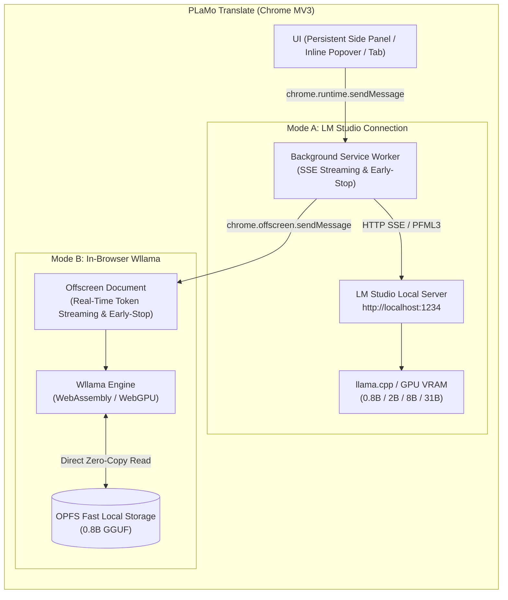

# PLaMo Translate (LM Studio & In-Browser Wllama)

English | [日本語](README.md)

A privacy-first, zero-cloud-dependency Chrome extension (Manifest V3 / Vanilla JS) that brings Preferred Networks (PFN)'s state-of-the-art open-weight translation model **PLaMo 3 Translate (0.8B / 2B / 8B / 31B)** directly into your browser.

Translate sensitive business documents, source code, and confidential text **100% locally on your machine with zero data leakage, high speed, and zero API costs**.

---

## Dual Inference Engine Architecture

This extension provides two distinct local inference engines tailored to different hardware environments and workflows. Switch between them instantly via the popup tabs or the Settings panel:



| Feature | Mode A: LM Studio Connection | Mode B: In-Browser Wllama |
| :--- | :--- | :--- |
| **Architecture** | Connects to local desktop server (LM Studio) via HTTP | **Runs 100% inside Chrome Extension** (Offscreen Document) |
| **Prerequisites** | **LM Studio desktop app installed & running** | **None** (Zero third-party apps required) |
| **Supported Models** | **All 0.8B, 2B, 8B, and 31B models**<br>(Quantized GGUF / FP16) | **PLaMo 3 Translate 0.8B**<br>(Official quantized GGUF variants) |
| **Hardware Acceleration** | LM Studio GPU offload (NVIDIA CUDA / Apple Metal / ROCm) | **WebGPU** hardware acceleration with automatic CPU WASM fallback |
| **Model Storage** | Managed by LM Studio local directory | Persisted in browser's **OPFS (Origin Private File System)** |
| **Best Used For** | Demanding tasks requiring 2B / 8B / 31B models with flagship quality | Instant, standalone translation without installing extra software |

---

## PLaMo 3 Translate Model Family

This extension is fully compatible with all parameter sizes and quantized GGUF variants (`Q4_K_M`, `Q4_0`, `Q8_0`, etc.) in the PLaMo 3 Translate family:

| Model Size | Parameters | Engine Modes | Characteristics & Recommended Hardware |
| :--- | :--- | :--- | :--- |
| **PLaMo 3 Translate 0.8B** | 800M | **Mode A & Mode B** | **Ultra-lightweight & ultra-fast**. Runs directly in browser via Wllama or in LM Studio. Ideal for day-to-day web browsing translation. |
| **PLaMo 3 Translate 2B** | 2 Billion | Mode A (LM Studio) | **Best balance of speed and accuracy**. Ideal for consumer desktop GPUs. |
| **PLaMo 3 Translate 8B** | 8 Billion | Mode A (LM Studio) | **High accuracy & expressive nuance**. Excels at translating complex clauses and academic texts (8GB–16GB VRAM recommended). |
| **PLaMo 3 Translate 31B** | 31 Billion | Mode A (LM Studio) | **Flagship translation quality**. Designed for high-performance workstations and local GPU servers. |

* All models share the exact same **PFML3 prompt architecture**, **53-language bidirectional translation**, **Japanese polite/plain style control**, and **Context / Glossary term enforcement**.

### Mode B GGUF Presets (`pfnet/plamo-3-translate-0.8b-GGUF`)

Easily selectable directly from the Settings panel:

1. **Q4_K_M** (~547MB) - **Recommended Default**. Best trade-off between translation quality and inference speed.
2. **Q4_0** (~522MB) - Standard 4-bit quantization.
3. **Q3_K_M** (~464MB) - Lightweight option for constrained memory.
4. **Q2_K** (~391MB) - Ultra-lightweight option with minimal download footprint.
*(Supports custom Hugging Face resolve URLs as well)*

---

## Key Features

1. **Real-Time Streaming & Proactive Early-Stop (Wllama & LM Studio Dual-Support)**:
   * Delivers instantaneous **typewriter-like token streaming** across both in-browser Wllama and LM Studio (via Server-Sent Events).
   * Employs proactive token monitoring for PLaMo-3 termination markers (`</s>`, `<|plamo:tag|>`, etc.), immediately aborting inference the instant generation finishes. This completely eliminates idle runaway spin-loops up to `max_tokens`.
2. **Persistent Chrome Side Panel & Full-Screen Tab**:
   * Clicking the toolbar icon opens the **Chrome Side Panel**, staying open beside your browser tabs so you can translate without losing context or interrupting your reading.
   * Seamlessly inspect source language detection, customize settings, or click **🗗** to open a full two-column widescreen workspace.
3. **Resizable & Draggable Inline Translation Popover**:
   * Selecting text on any webpage displays a floating `🌐 PLaMo` button or instant popup.
   * **Resize Handle**: Drag the bottom-right grip to freely adjust width and height. Custom dimensions are saved automatically for future selections.
   * **Draggable Header**: Grab the top `🌐 PLaMo` bar to reposition the card anywhere on screen (with viewport boundary clamping).
   * Inside input fields (`<input>`, `<textarea>`, `contenteditable`), click **"✍️ Replace"** to substitute text directly with the translation.
4. **Smart Article Extractor for Full-Page Translation**:
   * Automatically locates primary content containers (`<article>`, `<main>`, `[role="main"]`, `.markdown-body`).
   * Eliminates layout noise: automatically skips sidebars, advertisements, headers, footers, navigation menus, and social share widgets.
   * **Link Density Check**: Skips navigation links and indexes where anchor tags exceed 50% of the character count.
   * **Target Language Skip**: Automatically skips paragraphs already in Japanese when translating to Japanese.
   * Injects bilingual inline blocks viewport-first. Includes a floating control pill to **Pause/Resume**, **Hide/Show Original**, or **Restore** the page.
5. **Accurate Source Language Detection Badge**:
   * Detects the input language with high precision using Chrome's native CLD API and Unicode regex checks (strict Vietnamese diacritics and Spanish stopword evaluation), displaying a badge (e.g., `[English]`, `[Spanish]`) on the card and sidebar.
6. **Native PFML3 Prompt Format**:
   * Strictly constructs Preferred Networks' native markup tags (`<|plamo:tag|>`, `<|plamo:msg|>`, `<|plamo:key|>`, `<|plamo:val|>`) to maximize translation fidelity.
7. **Japanese Politeness & Form Control (Polite / Plain / Easy Japanese)**:
   * Explicitly choose Japanese sentence styling: **Polite** (`polite`: です/ます調), **Plain** (`plain`: だ/である調), or official **Easy Japanese** (`ja-easy` / `ja(easy)`).
8. **Context & Glossary Support**:
   * Supply background domain context or enforce custom term mapping pairs (e.g., `LLM=Large Language Model`).
9. **Smart Auto Ja↔En Language Swap**:
   * Automatically flips the target language to English when Japanese text is entered while target is set to Japanese (preserved as Japanese rewrite/refinement when specific styles like Polite, Plain, or Easy Japanese are selected).
10. **Serialized Offscreen Queue**:
    * In Mode B, multiple paragraph translation requests are dispatched through a mutex queue to ensure KV cache stability and prevent memory race conditions.

---

## Supported Languages (53 Languages + Easy Japanese)

All 53 languages officially supported by PLaMo 3 Translate, plus official **Easy Japanese**, are available:

> **Common**: English (`en`), Japanese (`ja`), **Easy Japanese (`ja-easy`)**, Chinese (`zh`), Korean (`ko`), French (`fr`), German (`de`), Spanish (`es`), Italian (`it`), Russian (`ru`), Vietnamese (`vi`), Thai (`th`), Indonesian (`id`), Arabic (`ar`), Dutch (`nl`), Polish (`pl`), Portuguese (`pt`), Turkish (`tr`), Hindi (`hi`), Ukrainian (`uk`), and 34 other supported languages.

> **💡 Easy Japanese Mode**:
> PLaMo 3 Translate natively supports Easy Japanese (PFML3: `ja-easy` / `ja(easy)`).
> Beyond translating from other languages into simplified Japanese, it can also **rewrite complex Japanese news and official documents into clear, accessible Japanese for non-native speakers and children**. You can activate it by picking "Japanese (Easy) (`ja-easy`)" from the language menu or selecting "Easy Japanese" from the style dropdown.

---

## Getting Started

### 1. Install Chrome Extension

1. Open Google Chrome and navigate to `chrome://extensions/`.
2. Toggle on **Developer mode** in the top-right corner.
3. Click **Load unpacked** in the top-left corner.
4. Select the downloaded/cloned folder (`PlaMo_translate`).
5. Pin the **PLaMo Translate** icon to your browser toolbar.

---

### 2. Choose Your Inference Mode

#### 【Mode B: In-Browser Wllama (Recommended & Zero Setup)】

No desktop software required:

1. Click the extension icon and select the **Mode B: In-Browser (Wllama)** tab.
2. Click **📥 Load Model**.
3. The GGUF model (~547MB) will download once from Hugging Face and be permanently cached in browser OPFS storage (a progress bar will display).
4. Once loaded (**Ready**), start translating immediately inside Chrome!

* WebGPU is automatically enabled if your browser and hardware support it; otherwise, it seamlessly falls back to CPU WebAssembly.

#### 【Mode A: LM Studio Connection (2B / 8B / 31B Models)】

For translating with heavier models on high-performance GPUs:

1. Download and start [LM Studio](https://lmstudio.ai/) on your PC.
2. Search and download your desired PLaMo model (`plamo-3-translate-2b`, `8b`, or `31b`).
3. In the **Local Server** tab (`<->`), load the model and click **Start Server** (default port: `1234`).
4. Select **Mode A: LM Studio** in the extension popup, open **⚙️ Settings**, and click **🔌 Test Connection**.

---

## Usage Guide

### 1. Side Panel Translation

- Click the extension icon in your browser toolbar to open the **Chrome Side Panel**.
- Enter or paste text, then press `Ctrl + Enter` (or click **Translate**) to stream translated text in real time.
- The detected source language badge (e.g., `[English]`, `[Japanese]`) automatically appears in the input card header.
- Click **🗗 Open in Full Tab** to expand into a widescreen two-column workspace.
- Expand **🛠️ Context & Glossary** to enforce custom translation pairs (e.g., `LLM=Large Language Model`).

### 2. In-Page Selection Translation (Resizable & Draggable)

- Highlight any text on a webpage.
- Click the floating `🌐 PLaMo` button near your selection to open the popover card with real-time streaming output.
- **Resize Handle**: Drag the bottom-right grip to freely resize the card (dimensions are remembered across sessions).
- **Draggable Header**: Grab the top `🌐 PLaMo` bar to reposition the card anywhere on your screen.
- **Language Badge**: View the automatically detected source language badge in the original text accordion.
- When editing text in form fields (`<input>`, `<textarea>`, `contenteditable`), click **✍️ Replace** to substitute text directly with the translation.

### 3. Smart Whole-Page Article Translation

- Click **🌐 Translate Whole Page** in the side panel, or right-click anywhere on the page and select **Translate this page with PLaMo Translate**.
- **Smart Content Extraction**: Automatically focuses on article body content and excludes sidebars, navigation bars, headers, footers, and advertisements.
- Bilingual translation blocks appear beneath each paragraph viewport-first.
- Use the bottom-right floating control pill to **Hide/Show Original**, **Pause/Resume**, or **Restore** the page.

---

## PFML3 Prompt Specification

This extension formats raw completion prompts according to Preferred Networks' official PFML3 specification (shared across Mode A and Mode B):

```text
<|plamo:tag|>dataset<|plamo:msg|>translation
<|plamo:tag|>context<|plamo:msg|>{context}
<|plamo:tag|>glossary<|plamo:key|>{source1}<|plamo:val|>{target1}<|plamo:key|>{source2}<|plamo:val|>{target2}
<|plamo:tag|>input<|plamo:key|>lang<|plamo:val|>{source_lang}<|plamo:msg|>{source_text}
<|plamo:tag|>output<|plamo:key|>lang<|plamo:val|>{target_lang}<|plamo:key|>form<|plamo:val|>{polite/plain}<|plamo:msg|>
```

### Stop Tokens

- `</s>`
- `<|plamo:tag|>`
- `<|plamo:bos|>`
- `<|plamo:eos|>`
- `<|endoftext|>`

---

## Extension Settings

Access **⚙️ Settings** to configure:

| Setting | Default | Description |
| :--- | :--- | :--- |
| **Inference Engine** | `LM Studio (Mode A)` | `LM Studio (Mode A)` or `In-Browser Wllama (Mode B)` |
| **UI Language** | `Auto` | Interface language (`Auto` / `Japanese` / `English`) |
| **In-Page Display Style** | `Floating Window (window)` | `Floating Window (window: Fastest P-core priority)` or `In-Page Card (iframe)` |
| **LM Studio Server URL** | `http://localhost:1234` | Local inference server endpoint for Mode A |
| **LM Studio Model** | Auto-detect | Select from `/v1/models` or enter custom model string |
| **LM Studio API Mode** | `completions` (Recommended) | `/v1/completions` (PFML3 raw) or `/v1/chat/completions` |
| **Wllama Preset Model** | `Q4_K_M (~547MB)` | Quantized GGUF model for Mode B (Q4_K_M / Q4_0 / Q3_K_M / Q2_K) |
| **WebGPU Acceleration** | `ON` (Enabled) | Use WebGPU acceleration for Mode B (falls back to CPU WASM if unsupported) |
| **Context Length (n_ctx)** | `2048` | Context window size for Mode B |
| **In-Page Translation Mode** | `button` | `button` (icon on select), `instant` (immediate popover), `off` |
| **Auto Ja↔En Switch** | `true` (Enabled) | Automatically flip target to English when input is Japanese |
| **Temperature** | `0.0` | Output determinism (0.0 is best for translation fidelity) |
| **Max Tokens** | `1024` | Maximum tokens generated per translation call |

---

## Troubleshooting

### Mode A (LM Studio Connection)

- **Q. Header displays "Disconnected" and translations fail**
  * Verify that LM Studio is open and the local server is started (**Start Server** in the `<->` tab).
  * Verify port number (`1234`) and click **🔌 Test Connection** in Settings.

### Mode B (In-Browser Wllama)

- **Q. Model download is interrupted or fails**
  * Verify network connectivity to Hugging Face.
  * In Settings, click **🗑️ Clear OPFS Cache** and retry downloading.
* **Q. WebGPU is not being used**
  * Navigate to `chrome://gpu` in Chrome and verify that "WebGPU: Hardware accelerated" is active.
  * If WebGPU is not supported, the extension automatically and safely falls back to CPU WebAssembly.

---

## Links & Credits

* **Built with PLaMo**
* **Preferred Networks Tech Blog**:  
  [PLaMo 3 Translate Release & Engineering Insights](https://www.preferred.jp/ja/blog/tech/plamo-3-translate-weight-release)
* **Hugging Face Model Repositories**:  
  * [pfnet/plamo-3-translate-0.8b-GGUF](https://huggingface.co/pfnet/plamo-3-translate-0.8b-GGUF)
  * [pfnet/plamo-3-translate-2b](https://huggingface.co/pfnet/plamo-3-translate-2b)
* **@wllama/wllama Engine**:  
  [https://github.com/ngxson/wllama](https://github.com/ngxson/wllama)
* **License**:
  * Extension Code: [MIT License](LICENSE)
  * PLaMo Translation Models: [PLaMo Community License](https://plamo.preferredai.jp/info/plamo-community-license-ja)
    * Free for personal, research, and non-commercial purposes without registration.
    * Entities with annual revenue under 1 billion JPY may use it for commercial purposes free of charge upon prior [registration](https://plamo.preferredai.jp/info/plamo-community-license-ja).
    * **Output Attribution Exemption (Article 5)**: Since PLaMo 3 Translate is classified as a "Transformation Model", users are **not required to attribute PLaMo on translation outputs**, allowing translated documents to be freely distributed in professional and business contexts.
